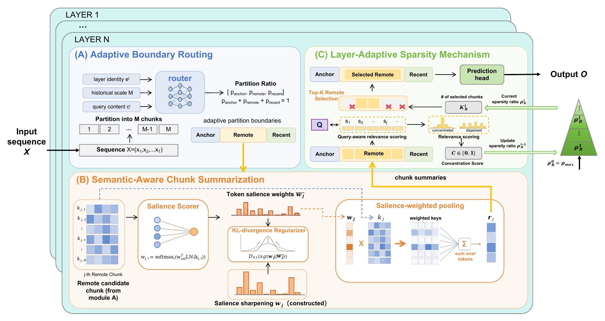

# PAVE

This repository accompanies the ICDE 2027 submission **PAVE: Adaptive Historical KV Management for Efficient Long-Context LLM Understanding**.

## Framework



PAVE partitions historical key-value chunks into Anchor, Remote, and Recent regions. It builds salience-weighted summaries for query-aware Remote retrieval and adapts the number of retained Remote chunks across layers.

## Benchmarks

| Benchmark | Backbones and inputs reported in the paper | Metric |
| --- | --- | --- |
| [RULER](https://github.com/NVIDIA/RULER) | Llama-2-7B Base, 4K–128K. Llama-3-8B Base, 8K–128K | Macro-average over 13 tasks |
| [L-Eval](https://github.com/OpenLMLab/LEval) | Llama-2-7B Base. TOEFL, QuALITY, Coursera, and SFiction | Zero-shot accuracy |
| [PG-19](https://github.com/google-deepmind/pg19) | Llama-2-7B Base, 4K–100K. Llama-3-8B Base, 8K–100K | Next-token perplexity |
| [Proof-Pile-ArXiv](https://huggingface.co/datasets/EleutherAI/proof-pile-2) | Llama-2-7B Base, 4K–100K | Next-token perplexity |

## Repository Structure

```text
PAVE/
├── pave/             # Core model
├── backbone/         # Base model download
├── baselines/        # Baseline runners and configs
├── dataset/          # Data preparation and evaluation inputs
├── evaluation/       # Benchmark and analysis runners
├── training/         # PAVE trainer and backbone configs
├── arguments.py      # Launcher arguments
├── framework.jpg     # Framework overview
├── main_dc.py        # Ablations, design choices, and hyperparameters
├── my_main.py        # Data preparation, training, and benchmark evaluation
├── run.sh            # Command launcher
├── utils.py          # Shared launcher utilities
└── requirements.txt
```

## Requirements

Use Python 3.10+, CUDA-enabled PyTorch, and a BF16-capable NVIDIA GPU. Run commands from the repository root. Use a separate data environment with Transformers 4.55.2 for the Llama-3 tokenizer, `datasets`, and the pinned RULER checkout's dependencies.

```bash
python -m pip install packaging ninja wheel
python -m pip install -r requirements.txt --no-build-isolation
bash run.sh --help
```

## Data Preparation

Use local Base model directories or authenticate with `hf auth login` and run the model download helper.

```bash
DATA_PYTHON=/absolute/path/to/data-env/bin/python
LLAMA2="$PWD/models/Llama-2-7b-hf"
LLAMA3="$PWD/models/Meta-Llama-3-8B"
MODELS_DIR="$PWD/models" python backbone/download_models.py

PYTHON="$DATA_PYTHON" bash run.sh prepare-longalpaca --output-dir data/longalpaca
```

Prepare the RULER assets at the pinned revision. Use `--backbone llama3 --tokenizer "$LLAMA3"` for Llama-3 prompts and repeat `--length` to choose specific lengths. [RULER setup](https://github.com/NVIDIA/RULER/tree/c3f5e3b4f87f97e048793bb510a3a6b19a46bf3a#1-download-data)

```bash
mkdir -p data
git clone https://github.com/NVIDIA/RULER.git data/RULER
git -C data/RULER checkout c3f5e3b4f87f97e048793bb510a3a6b19a46bf3a
(
  cd data/RULER/scripts/data/synthetic/json
  "$DATA_PYTHON" download_paulgraham_essay.py
  bash download_qa_dataset.sh
)
PYTHON="$DATA_PYTHON" bash run.sh prepare-ruler --backbone llama2 \
  --ruler-root data/RULER --tokenizer "$LLAMA2" --output-dir data/ruler
```

The L-Eval inputs are in [`dataset/l_eval/`](dataset/l_eval/). The PPL preparation commands produce token streams and manifests.

```bash
PYTHON="$DATA_PYTHON" bash run.sh prepare-pg19 --model llama2 \
  --model-path "$LLAMA2" --output-path data/ppl/pg19.bin
PYTHON="$DATA_PYTHON" bash run.sh prepare-arxiv \
  --model-path "$LLAMA2" --output-path data/ppl/arxiv.bin
```

## Model Training

Train the router and chunk summarizer on LongAlpaca-12k with the backbone frozen, using answer cross-entropy and salience KL. The configs use 8K, 16K, 24K, and 32K token buckets.

```bash
bash run.sh train --config training/configs/llama2_7b.json \
  --model-path "$LLAMA2" --data-dir data/longalpaca --output-dir runs/pave-llama2

bash run.sh train --config training/configs/llama3_8b.json \
  --model-path "$LLAMA3" --data-dir data/longalpaca --output-dir runs/pave-llama3 \
  --tokenizer-python "$DATA_PYTHON"
```

## Evaluate PAVE

The public PAVE runners below use a local Llama-2 snapshot and the archived PAVE checkpoint. The full RULER runner covers 8K, 16K, and 32K. To use a newly trained Llama-2 checkpoint for RULER, set `PAVE_PT` to its `best.pt` and add `--allow-different-checkpoint`.

```bash
PAVE_PT=/absolute/path/to/pave-llama2.pt

bash run.sh ruler --model-path "$LLAMA2" --checkpoint "$PAVE_PT" \
  --data-dir data/ruler/llama2 --output-dir runs/ruler
bash run.sh l-eval --model-path "$LLAMA2" --checkpoint "$PAVE_PT" \
  --data-dir dataset/l_eval --output-dir runs/l-eval
bash run.sh ppl --model-path "$LLAMA2" --checkpoint "$PAVE_PT" \
  --inputs data/ppl/pg19.bin --dataset pg19 --length 32768 --stride 32768 \
  --max-windows 10 --output-dir runs/ppl
bash run.sh ablation --model-path "$LLAMA2" --checkpoint "$PAVE_PT" \
  --data-dir data/ruler/llama2 --length 32768 --output-dir runs/ablation
```

For L-Eval scoring, add `--scorer /absolute/path/to/auto_eval.py`. For ArXiv PPL, use `data/ppl/arxiv.bin` and `--dataset arxiv`. The 64K RULER ablation requires prompts generated with `--length 65536`. The `design-choice` and `hyper` commands use the archived 32K JSONL windows.

## Run Baselines

Use each method's environment and config in [`baselines/`](baselines/). The following example runs DCA at three lengths.

```bash
bash run.sh baseline dca download --backbone llama2 --source-dir data/upstream/dca
bash run.sh baseline dca evaluate --backbone llama2 --source-dir data/upstream/dca \
  --model-path "$LLAMA2" --data-dir data/ruler/llama2 --length 8192 16384 32768 \
  --output-dir runs/dca
```

For the Llama-3 LongAlpaca-12k fine-tuning recipes, run `bash run.sh baseline METHOD train --help` with `yarn`, `longlora`, or `landmark_attention`. Run `bash run.sh baseline METHOD evaluate --help` for the method's checkpoint options.
